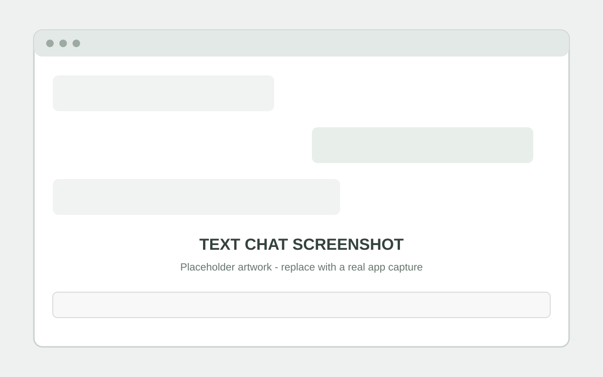
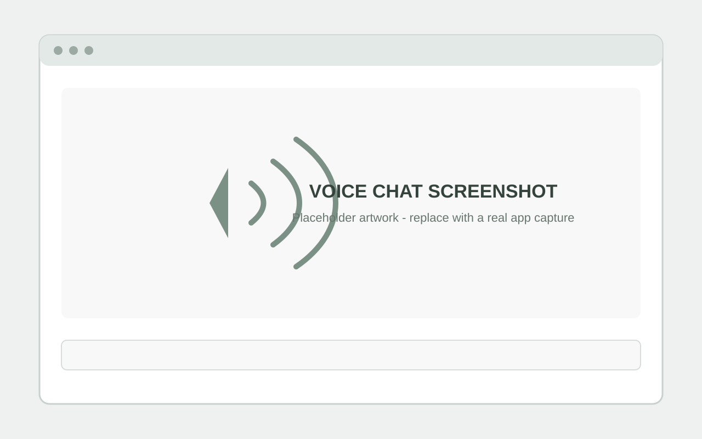

# RIKO

**A local-first AI companion for text and voice.** RIKO separates conversation management, prompts, language-model access, speech recognition, speech synthesis, and configuration so its components can evolve independently.

> **Status:** Active development. Features, interfaces, and setup requirements may change.

**On this page:** [Features](#features) | [Install and run](#install-and-run) | [Desktop GUI](#graphical-interface) | [Screenshots](#screenshots) | [Profiles](#profile-and-local-assets) | [Development](#development-and-testing)

## Features

- **Local LLM integration:** Connects to Ollama using `qwen3:4b-instruct`.
- **Text and voice modes:** Select Text Chat or Voice Chat from the terminal menu or the GUI.
- **Cross-platform desktop GUI:** A native Tkinter window calls RIKO's Python conversation, microphone, Faster-Whisper, Kokoro, and audio playback components directly. It does not use a browser or local GUI web server.
- **Streaming responses:** Supports incremental model output.
- **Speech recognition:** Includes microphone capture and a Faster-Whisper speech-to-text (STT) pipeline.
- **Speech synthesis:** Uses Kokoro ONNX for local text-to-speech (TTS) and audio playback.
- **Profiles, personas, and behavior controls:** Offers an editable private profile, selectable bundled/custom profile contexts, and adjustable cuteness, playfulness, teasing, affection/warmth, energy, talkativeness, spontaneity, initiative, emotional awareness, reassurance, and response style.
- **Optional speech cache:** Read Aloud can reuse local Kokoro audio for repeated phrases. It is off by default, capped at 128 MB, and can be cleared in Preferences.
- **Conversation management:** Maintains session history and coordinates model interactions.
- **Architecture-aware answers:** An allow-listed tool retrieves documented information about RIKO's architecture, modules, configuration, and capabilities.
- **Modular startup:** Text Chat can be selected without immediately importing voice-specific dependencies.

## Architecture at a Glance

```text
                         User
                          |
                +---------+---------+
                |                   |
             Text Chat           Voice Chat
                                    |
                                Microphone
                                    |
                          Speech Recognition (STT)
                                    |
                              Recognized text
                |                   |
                +---------+---------+
                          |
                 Conversation Manager
                          |
                     Prompt Manager
                          |
                    Ollama / Qwen
                          |
                    Model response
                          |
                +---------+---------+
                |                   |
            Text output         Kokoro ONNX
                                    |
                               Audio playback
```

This is a conceptual overview; it does not imply that every path or feature is production-ready.

## Technology Stack

| Component | Technology |
|---|---|
| Language | Python |
| Local LLM runtime | Ollama |
| Chat model | `qwen3:4b-instruct` |
| Speech-to-text | Faster-Whisper |
| Text-to-speech | Kokoro ONNX |
| Audio I/O | `sounddevice`, `soundfile` |
| Numerical audio processing | NumPy |
| Tests | Python tests organized by test type |

## Requirements

- **Windows:** Windows 10/11, CMD, Git, `curl.exe`, and `winget` for automatic Python/Ollama installation when missing. Python 3.10+ is required; Python 3.11 is installed by winget if needed.
- **Linux:** Debian/Ubuntu with `apt-get`, `sudo` (or root), and Python 3.10+ available through distribution repositories. The installer installs Python venv/build tools, audio libraries, and Ollama.
- Internet access and enough free disk space for the Python environment, Ollama model, Kokoro files (about 120 MB combined), and Faster-Whisper model cache.
- Tkinter desktop support (included with standard Windows Python distributions; installed by the Debian/Ubuntu installer).
- A working microphone and audio output device for live Voice Chat and the desktop GUI's Voice mode.

## Install and run

The root-level installers create or reuse `.venv-tts`, install Python requirements, fetch Kokoro model and voice files, install or check Ollama, download `qwen3:4b-instruct`, warm the Faster-Whisper `base` cache, and start the separate profile setup if no personal profile exists. Profile setup asks for confirmation before saving. Valid existing model files and profiles are preserved.

> **Linux download retry note:** If a Kokoro asset download fails, `install.sh` preserves the partial file under `models/kokoro/` with a `.part` suffix. Inspect or remove that partial asset before retrying.

### Windows CMD

```bat
git clone https://github.com/amartyasinghnamra/RIKO-Major-Project.git
cd RIKO-Major-Project
install.bat
run.bat
```

Git is needed to clone the repository. If Python, Ollama, or curl is missing, `install.bat` installs it through `winget`; open a new CMD window and rerun the installer if a newly installed command has not appeared on PATH. Without `winget`, install Python 3.11+, Ollama, and curl from their official installers, then rerun `install.bat`.

### Linux (Debian/Ubuntu)

```sh
git clone https://github.com/amartyasinghnamra/RIKO-Major-Project.git
cd RIKO-Major-Project
bash install.sh
bash run.sh
```

`install.sh` uses `sudo` to install apt packages, Tkinter, and Ollama. Other Linux distributions are not auto-configured; install Python 3.10+, venv/pip, Tkinter, a compiler toolchain, PortAudio, libsndfile, libespeak-ng, curl, and Ollama before adapting/running the script. The virtual environment is always project-local and `run.sh` invokes it without needing shell activation.

### Graphical interface
### Downloadable packages

The `Build desktop packages` GitHub Actions workflow creates a Windows `RIKO-Setup.exe` installer and an x86_64 Linux AppImage. Download generated artifacts from a completed workflow run; release assets are not published automatically.

Both packages download Python dependencies and model assets during setup rather than bundling the roughly 2 GB model payload. Windows installs RIKO per user and runs the existing setup script. On first launch, the AppImage copies the application files to `${XDG_DATA_HOME:-~/.local/share}/RIKO`, then opens a terminal for setup. Linux setup installs system prerequisites with `apt-get` and may request `sudo`; automatic setup supports Debian/Ubuntu. Internet access is required. The AppImage is an installer/launcher, not a fully self-contained offline runtime.

### Graphical interface

RIKO includes a native Tkinter desktop app. It shares the CLI's chat sessions and audio pipeline; it is not a browser wrapper and does not start a local GUI web server. Microphone and speaker access use the operating system's audio devices directly.

#### Launch the GUI

| Platform | Command |
|---|---|
| Windows CMD | `run-gui.bat` |
| Debian/Ubuntu Linux | `bash run-gui.sh` |

#### Text chat

- **Regenerate** retries the latest text turn with its preceding conversation context.
- **Read aloud** uses Kokoro on request and strips Markdown formatting before synthesis. The **Enable text in, voice out** preference controls availability.
- Optional Read aloud caching is off by default, limited to 128 MB, stored under `config/local/audio_cache/`, and clearable from Preferences. Hands-free Voice mode continues to use streaming synthesis.
- The microphone control creates a Faster-Whisper transcript draft in the composer. Stop recording to finalize it, review it, then send. Each recording is limited to two minutes.

#### Voice chat

Selecting **Voice** starts listening; selecting **Chat** stops listening and playback. Voice mode has no separate record control. The shared `VoiceChatSession` streams Ollama output into Kokoro, displays recognized speech and generated text, and returns to listening after a response is stopped. Speaking over a response can interrupt generation and capture the new utterance. Short commands such as “stop,” “wait,” “pause,” and “hold on” are treated as controls. Headphones are recommended because acoustic echo cancellation is not implemented.

While a reply is generating, **Send** becomes **Stop**. Press it or **Escape** to cancel the active Ollama stream and Kokoro playback; Voice mode stays active and returns to listening.

#### Preferences and display

**Tune RIKO's personality** provides ten 0–10 controls and response-style presets. Teasing remains gentle, affection/warmth is non-romantic by default, and the user's current request and serious tone take priority. Local overrides are saved to `config/local/behavior.local.json` and apply to the next model reply. **Your profile** selects Personal, Demo, or another available profile and edits the private personal profile. Saved conversation style applies to the next model turn; Kokoro voice and pace apply to the next spoken phrase.

Zoom ranges from **80% to 160%** using the **− / +** controls. Keyboard shortcuts are **Ctrl + Plus/=** and **Ctrl + -** on Windows/Linux, **Command + Plus/Minus** on macOS, and **Ctrl/Command + 0** to reset. Holding Ctrl/Command while scrolling also zooms. Tkinter Canvas draws the rounded chat surfaces; the operating system draws the title bar. Close the window to exit.

### Screenshots

These images are intentional placeholders, not captures of the current application. Replace them with real screenshots when available.



*Text chat — streaming reply placeholder.*



*Voice chat — listening and spoken response placeholder.*

### Profile and local assets

The installer opens `src/create_user_profile.py` when no personal profile exists. Saving or replacing a profile requires explicit confirmation.

- Personal profile: `config/local/user_profile.json` (ignored by Git).
- Additional named profiles: `config/local/profiles/`; create one with `python src/create_user_profile.py --id study`.
- Bundled Demo profile: `config/examples/profiles/demo.json`; fictional, read-only, and used only when selected.
- Profile context and behavior preferences enter the prompt through `{user_profile}` and `{behavior_instructions}`. Neither rewrites `prompts/system_prompt.txt`.
- Personal and named profiles, behavior overrides, cached audio, and settings remain local. Project prompts, personas, and other tracked files come from the clone.
- Kokoro model assets are stored under `models/kokoro/` and are not committed. Review upstream model and voice terms before redistribution.

The terminal menu offers:

- `1` — Text Chat
- `2` — Voice Chat
- `3` — Settings & Selectors (persona, Kokoro voice and speed, and profile context)
- `0` — Exit

Create or edit local profiles from the repository root with:

```bat
python src\create_user_profile.py
python src\create_user_profile.py --id study
```

```sh
.venv-tts/bin/python src/create_user_profile.py
.venv-tts/bin/python src/create_user_profile.py --id study
```

The GUI and CLI both build system context through `PromptManager`. Profile data uses the existing `{user_profile}` placeholder and behavior controls are formatted through `{behavior_instructions}`; neither feature rewrites `prompts/system_prompt.txt`.

Text Chat requires the local Ollama service and downloaded chat model. Voice Chat additionally requires the speech/audio packages and model assets installed by the OS-specific installer, plus a microphone and audio output device. Faster-Whisper may use additional model cache space on its first load if the cache was cleared.

The current website content and design constraints are recorded in [website_prompt.md](website_prompt.md). Keep its implementation claims aligned with the tested project capabilities.

## Development and Testing

Compile the Python source files:

```bat
python -m compileall -q src audio
```

Tests are organized under `tests/` by type, including unit, integration, and audio tests. Run the test suite using the test runner and dependencies configured for your checkout. For example, if `pytest` is installed and configured:

```bat
python -m pytest
```

Some tests may require optional dependencies, audio hardware, model assets, or a running Ollama service. Compilation checks syntax; it does not prove that the full live voice pipeline works. Perform a real microphone-to-transcription-to-response-to-audio test before a demo or release.

## Configuration and Privacy

- Keep private profile data and local overrides on your machine; do not commit them.
- Never commit credentials, API keys, `.env` files, private recordings, or personal configuration.
- Local inference can reduce dependence on hosted model APIs, but it does not automatically mean every dependency or integration works offline. Verify each component before using sensitive data.
- RIKO's architecture lookup uses allow-listed documentation topics; it is not designed to expose arbitrary filesystem paths.

## Repository Layout

This is a high-level guide to the main areas, not an exhaustive listing of every file.

```text
RIKO-Major-Project/
├── audio/
│   ├── kokoro/              # Text-to-speech
│   └── stt/                 # Microphone input and speech recognition
├── config/
│   ├── defaults/
│   ├── examples/
│   │   └── profiles/       # Bundled fictional profile presets
│   ├── local/               # Private local configuration
│   └── personas/
├── knowledge/
│   └── architecture/        # Architecture knowledge used by the tool
├── models/
│   └── kokoro/              # Local model assets; weights are not committed
├── prompts/                 # System prompts and mode styles
├── GUI/                     # Native Tkinter desktop chat and voice interface
├── src/
│   ├── modes/               # Text Chat and Voice Chat
│   ├── tools/               # Architecture-information tool
│   ├── conversation_manager.py
│   ├── debug_logger.py
│   ├── ollama_client.py
│   ├── user_profile.py      # Profile schema validation and normalization
│   ├── create_user_profile.py # Interactive local profile setup/editor
│   └── prompt_manager.py
├── tests/
│   ├── unit/
│   ├── integration/
│   └── audio/
├── requirements.txt
├── install.bat
├── install.sh
├── run.bat
├── run.sh
├── run-gui.bat
├── run-gui.sh
├── .gitignore
└── README.md
```

## Known Limitations

- RIKO is under active development; behaviour and interfaces may change.
- The current desktop GUI uses Tkinter; GTK4 is not implemented.
- Transcription quality and latency depend on the STT model, microphone, CPU performance, and environment.
- Initial model downloads and initialization may take time.
- Voice interaction depends on correctly installed audio dependencies and local model assets.
- Automated tests do not replace a live end-to-end voice test.

## License

RIKO is released under the MIT License. See [LICENSE](LICENSE) for details.
